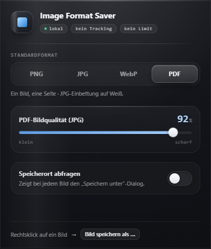

# Image Format Saver

Web-Bilder per Rechtsklick als **PNG, JPG, WebP oder PDF** speichern. Die Konvertierung läuft im Browser, ohne Account, Tracking oder externen Konvertierungsdienst.

Für Chrome und Microsoft Edge auf Basis von Manifest V3. Aktuell: **1.2.1**, deutschsprachige Oberfläche. Noch nicht in einem Extension-Store veröffentlicht.



## Funktionen

- Vier Formate im Bild-Kontextmenü und ein wählbares Standardformat.
- Qualitätsregler für JPG, WebP und das in PDF eingebettete JPG.
- Wahlweise „Speichern unter“-Dialog oder direkter Download.
- Transparenz bei PNG/WebP, weißer Hintergrund bei JPG/PDF.
- Downloadstatus und verständliche Fehler bei geschützten Bildern.
- Einstellungen können über die aktivierte Browser-Synchronisierung zwischen Geräten übertragen werden.

## Lokal installieren

1. Dieses Repository herunterladen und entpacken oder klonen.
2. `chrome://extensions/` bzw. `edge://extensions/` öffnen.
3. **Entwicklermodus** aktivieren und **Entpackte Erweiterung laden** wählen.
4. Den Unterordner **image-format-saver** auswählen.
5. Auf einer Website ein Bild mit der rechten Maustaste anklicken → **Image Format Saver** → **Bild speichern als …** → Format auswählen. Das Browsermenü kann mehrere Einträge der Extension unter ihrem Namen bündeln.

Das Toolbar-Popup dient zum Einstellen von Standardformat, Qualität und Speicherdialog.

## Entwicklung und Upload-ZIP

Die Extension hat keine Laufzeit-Abhängigkeiten und benötigt keinen Build. Für die Prüfungen: Node.js 22 oder neuer. Die ZIP-Erstellung benötigt Windows PowerShell oder PowerShell.

```powershell
npm run check
npm test
npm run package
```

Das Store-Paket liegt unter `dist/image-format-saver-1.2.1.zip`. Es enthält ausschließlich die benötigten Extension-Dateien mit `manifest.json` direkt im ZIP-Hauptverzeichnis. GitHub Actions führt die Prüfungen aus und stellt das ZIP als Workflow-Artefakt bereit. Unter macOS/Linux lässt sich das Paket mit `pwsh -File scripts/package.ps1` erzeugen.

## Berechtigungen und Datenschutz

| Berechtigung | Zweck |
| --- | --- |
| `contextMenus` | Bildformate im Rechtsklick-Menü anbieten. |
| `downloads` | Die konvertierte Datei speichern und ihren Status prüfen. |
| `storage` | Einstellungen in `storage.sync`, letzten Status lokal und laufende Download-IDs im Sitzungsspeicher halten. |
| `offscreen` | Canvas und Bildkonvertierung außerhalb des sichtbaren Popups verwenden. |
| `http://*/*`, `https://*/*` | Das ausgewählte Bild von seiner Quelle abrufen, auch von Bild-CDNs mit anderer Domain. |

Die Extension lädt ausschließlich auf Nutzeraktion das ausgewählte Bild von dessen ursprünglichem Server. Dabei können vorhandene Anmeldedaten/Cookies für diese Quelle mitgesendet werden; der Abruf unterliegt den Browserregeln. Der Bildanbieter erhält die üblichen Netzwerkdaten des Abrufs. Bilder und URLs werden nicht an einen vom Entwickler betriebenen Dienst gesendet. Bei aktivierter Browser-Synchronisierung verarbeitet der Browseranbieter die vier Einstellungswerte. Details: [Datenschutzentwurf](docs/PRIVACY.md).

## Grenzen

- Geschützte Bildquellen, Anmeldung, Anti-Hotlinking oder abgelaufene Links können den Abruf verhindern.
- Seitengebundene `blob:`-URLs lassen sich nicht zuverlässig aus der Extension abrufen. `data:`-Bilder können konvertiert werden.
- Animierte Bilder werden als einzelnes statisches Bild ausgegeben. Animationen und ursprüngliche Metadaten bleiben nicht erhalten.
- SVG wird gerastert, sofern der Browser es decodieren kann. CSS-Hintergründe und Canvas-Flächen besitzen kein normales Bild-Kontextmenü.
- PDF enthält genau eine Seite und ein JPG. Es ist verlustbehaftet und besitzt keine OCR oder Vektorerhaltung.
- Sehr große Bilder können Speicher- oder Nachrichtenlimits des Browsers erreichen.
- Firefox und Safari werden aktuell nicht unterstützt.

## Veröffentlichung und Mitarbeit

[Veröffentlichungsanleitung](docs/PUBLISHING.md) · [Store-Texte](docs/STORE-LISTING-DE.md) · [Technische Prüfung](docs/REVIEW.md) · [Änderungen](CHANGELOG.md)

Fehler können über [GitHub Issues](https://github.com/Rambo8i/image-format-saver/issues) gemeldet werden. Bei privaten Bildquellen bitte keine Cookies, Zugangsdaten oder vertraulichen Bild-URLs posten.

## Lizenz

Die Lizenzentscheidung des Rechteinhabers steht noch aus. Dieses Repository ist öffentlich einsehbar; eine Open-Source-Lizenz wird dadurch nicht automatisch erteilt. Vor einer entsprechenden Kennzeichnung sind eine Lizenz und die Rechte an Code und Logo zu klären.
